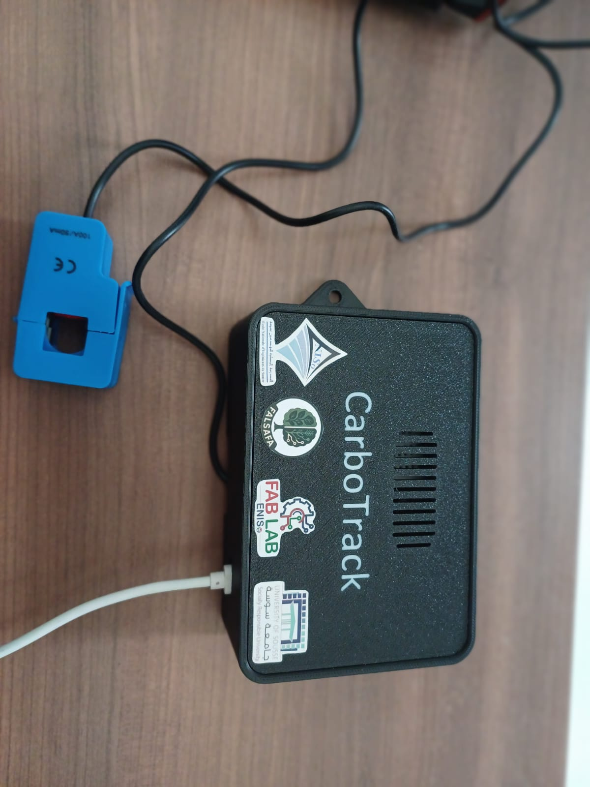
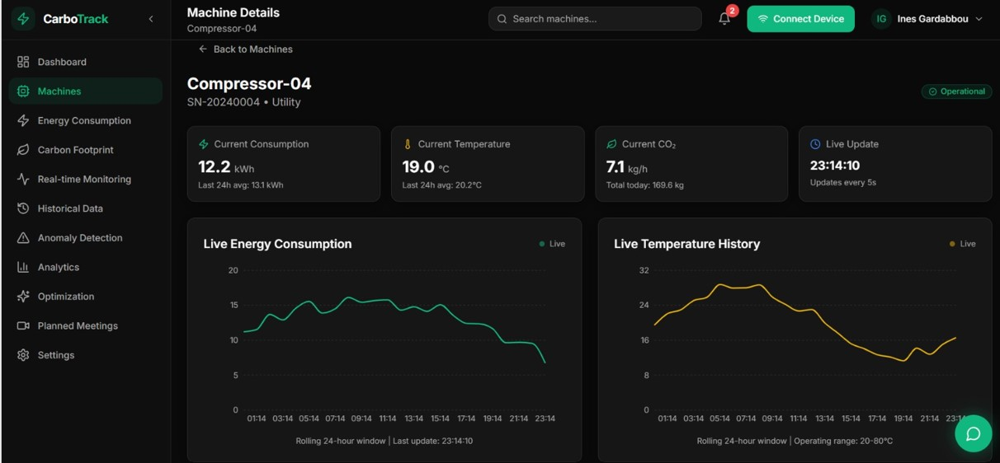
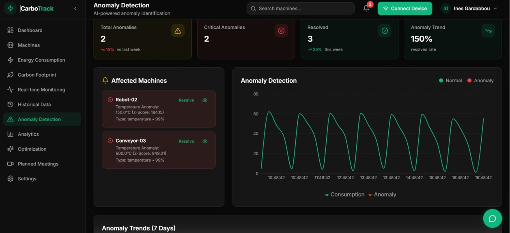
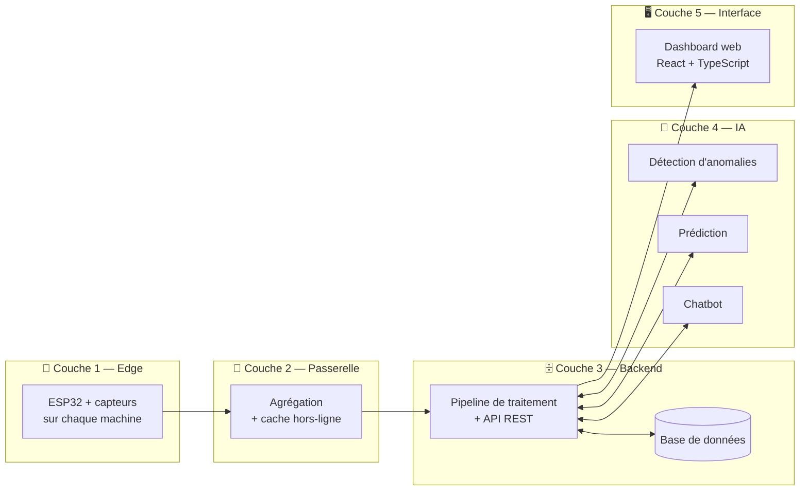

<div align="center">

# 🌱 CarboTrack

### Mesure et optimisation de l'empreinte carbone, machine par machine
<div align="center">



</div>

*Une solution IoT et IA pour mesurer en temps réel la consommation
énergétique de chaque machine, la convertir en empreinte carbone et
détecter les dérives avant qu'elles ne coûtent cher.*


</div>

---

## 📑 Sommaire

- [🌱 CarboTrack](#-carbotrack)
    - [Mesure et optimisation de l'empreinte carbone, machine par machine](#mesure-et-optimisation-de-lempreinte-carbone-machine-par-machine)
  - [📑 Sommaire](#-sommaire)
  - [🔍 Aperçu](#-aperçu)
  - [🎬 Démo](#-démo)
    - [Défis techniques relevés](#défis-techniques-relevés)
  - [✨ Fonctionnalités](#-fonctionnalités)
  - [🏗️ Architecture](#️-architecture)
    - [🔧 Hardware — prototype](#-hardware--prototype)
  - [🧰 Stack technique](#-stack-technique)
  - [📁 Structure du dépôt](#-structure-du-dépôt)
  - [🏭 Du prototype à l'industrialisation](#-du-prototype-à-lindustrialisation)
  - [🔐 Sécurité et conformité](#-sécurité-et-conformité)
  - [✅ Tests et validation](#-tests-et-validation)
  - [👥 Équipe \& contexte](#-équipe--contexte)

---

## 🔍 Aperçu

**CarboTrack** est une solution IoT industrielle de monitoring énergétique
en temps réel, couplée à des algorithmes d'intelligence artificielle. Elle
convertit la consommation électrique de chaque machine en empreinte carbone
exploitable, pour la détection d'anomalies, la prédiction de consommation et
l'optimisation des émissions.

La plupart des solutions existantes se limitent à des mesures agrégées au
niveau du site ou de la ligne de production. CarboTrack instrumente
**chaque machine individuellement**, ce qui permet :

- d'identifier précisément les machines responsables des dérives,
- d'obtenir une **traçabilité carbone fine jusqu'au produit fini**
  (exigée par des cadres comme la directive européenne CSRD),
- d'optimiser l'énergie au niveau des processus de production.

---

## 🎬 Démo






---


### Défis techniques relevés

- **Acquisition fiable** de la tension, du courant et de la puissance en environnement industriel bruité
- **Traitement embarqué** en temps réel sur un microcontrôleur aux ressources limitées
- **Communication robuste** malgré les environnements métalliques qui perturbent les signaux RF
- **Précision des modèles d'IA**, avec un faible taux de faux positifs
- **Conformité industrielle** : sécurité électrique et compatibilité électromagnétique

---

## ✨ Fonctionnalités

| | |
|---|---|
| ⚡ **Monitoring temps réel** | Tension, courant, puissance et énergie par machine |
| 🌍 **Empreinte carbone** | Par machine, par lot de production et par produit fini |
| 🚨 **Détection d'anomalies** | Identification automatique des machines à comportement anormal |
| 🔮 **Prédiction** | Consommation et émissions de CO₂ futures à partir de l'historique |
| 💬 **Chatbot conversationnel** | Aide à l'interprétation des données et recommandations d'optimisation |
| 📊 **Analyse multi-niveaux** | Site, ligne de production, machine, département |
| 📤 **Export des rapports** | CSV, Excel et PDF pour l'audit et la conformité |
| 🔐 **Accès par rôles** | Gestion des droits selon le profil utilisateur |

---

## 🏗️ Architecture



Cinq couches assurent une séparation claire des responsabilités :

1. **Edge computing** : acquisition des grandeurs physiques et traitement préliminaire sur chaque machine
2. **Passerelle** : concentration des flux, avec un cache qui absorbe les coupures réseau
3. **Backend et stockage** : base de données, pipeline de traitement et API REST
4. **Intelligence artificielle** : analyses exécutées de façon asynchrone par rapport au flux temps réel
5. **Interface utilisateur** : visualisation, configuration et recommandations de l'IA


### 🔧 Hardware — prototype

| Fonction | Composant | Rôle |
|---|---|---|
| Microcontrôleur | **ESP32-WROOM-32** | Calcul, Wi-Fi intégré, faible coût |
| Courant | **ACS712 (30 A)** | Capteur à effet Hall, mesure non intrusive, isolation galvanique |
| Tension | **ZMPT101B** | Transformateur miniature, isolation et adaptation du niveau |
| Température | **DS18B20** | Corréler les surchauffes avec les surconsommations |
| Vibrations | **SW-420** | Détection simple (accéléromètre tri-axe prévu ensuite) |
| Alimentation | Adaptateur 230 V / 5 V | Avec varistance, fusible et protection des entrées analogiques |

Après calibration, la précision globale obtenue est de l'ordre de **1 à 2 %**,
suffisante pour le monitoring énergétique et la détection de dérives.


## 🧰 Stack technique

<div align="center">

| Couche | Technologies |
|---|---|
| **Frontend** | React, TypeScript, Vite |
| **UI / Style** | shadcn/ui, Tailwind CSS |
| **Hardware** | ESP32, ACS712, ZMPT101B, DS18B20, SW-420 |
| **IA** | Détection d'anomalies, prédiction, chatbot |
| **Communication** | Wi-Fi (prototype), API REST |

</div>

---

## 📁 Structure du dépôt

```
CarboTrack/
├── README.md              # Ce fichier
├── demo/                  # Images de démonstration
│   ├── banner.png
│   ├── demo1.png
│   ├── demo2.png
│   ├── architecture-iot.png
│   └── cablage.png
├── public/                # Fichiers statiques
├── src/                   # Code source du dashboard (React + TypeScript)
├── package.json
└── vite.config.ts
```

> 🔧 Adapte cet arbre aux vrais fichiers de ton dossier.

---
---

## 🏭 Du prototype à l'industrialisation

Le projet suit une démarche en deux phases : valider le concept avec des
composants standard, puis migrer vers du matériel certifié. Grâce à une
couche d'abstraction matérielle, le logiciel et les modèles d'IA restent
**réutilisables** d'une phase à l'autre.


---

## 🔐 Sécurité et conformité

- **Matériel** : protections électriques (varistance contre les surtensions, fusible) et isolation pour protéger les équipements et les opérateurs
- **Logiciel** : communications chiffrées et gestion des accès par rôles utilisateurs
- **Réglementation** : traçabilité des données, protection des informations industrielles sensibles et respect des normes applicables aux environnements industriels

---

## ✅ Tests et validation

- Essais fonctionnels et tests de charge
- Validation en conditions réelles sur des machines industrielles représentatives
- Comparaison des mesures avec des instruments de référence (précision et répétabilité)
- Scénarios de défaillance : perte réseau, surcharge électrique, bruit électromagnétique

---

## 👥 Équipe & contexte

(année universitaire 2025-2027).

> Ines Gardabbou

> Mariam Gafsi

---
